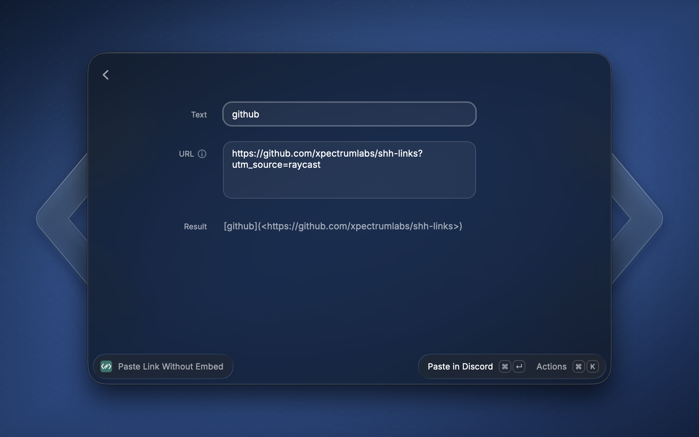
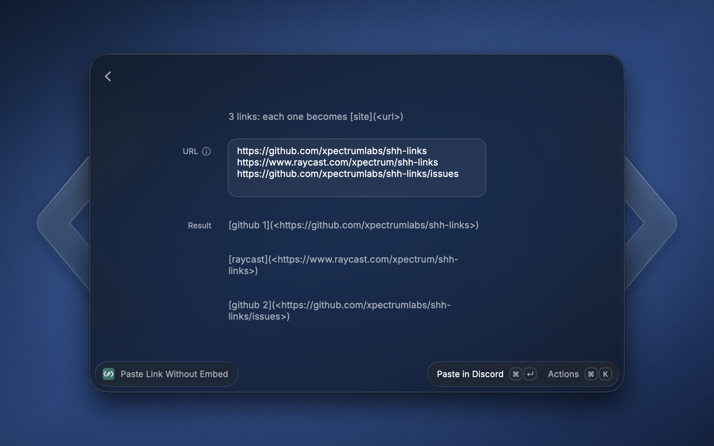
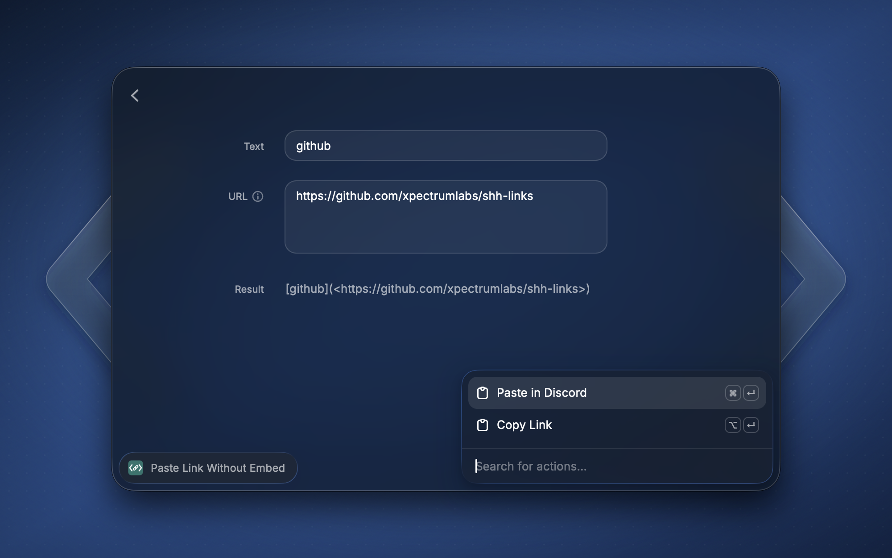

# Shh Links

Paste links into Discord without the preview card. Discord adds a big embed under every link you send unless the URL is wrapped in angle brackets, and typing `[text](<url>)` by hand gets old fast. Shh Links is a Raycast extension that builds that markup for you and pastes it straight into Discord's message box.



<p>
  
  
</p>

- **Paste Link Without Embed** opens a form with the text and URL taken from the clipboard, so you can check the result before pasting.
- **Paste Clipboard Without Embed** skips the form: the links on the clipboard go into Discord right away, each one named after its site.

It pastes but never sends, so you can still read the message over before pressing Enter. See [extension/README.md](extension/README.md) for everything it does.

## Install

Shh Links is waiting for review in the Raycast Store. Until it is published there, install it from this repository.

You need macOS, [Raycast](https://www.raycast.com), [Node.js](https://nodejs.org) 22 or later (`nvm use` picks it from `.nvmrc`) and the Discord desktop app.

```sh
git clone https://github.com/xpectrumlabs/shh-links.git
cd shh-links/extension
npm ci
npm run build
```

Both commands then show up in Raycast's search. To update later, run `git pull` and `npm run build` again from the same folder.

### Assign a hotkey

The commands are most useful on a hotkey, **Paste Clipboard Without Embed** above all: copy a link, press the hotkey in Discord, done.

1. Open Raycast Settings (`⌘,` while Raycast is open) and go to **Extensions**.
2. Find **Shh Links** and select the command.
3. Click **Record Hotkey** and press the combination you want, for example `⌃⌥V`.

### Use it

1. Copy a link (or several).
2. Click Discord's message box.
3. Run either command. With the form, press `⌘↵` to paste.

Select words in the message box before running a command and they become the link text.

Links lose their tracking parameters (`utm_*`, `fbclid`, `gclid` and the like) on the way. To keep them, turn off **Remove tracking parameters** in the extension's settings in Raycast.

## Development

- `extension/`: the extension itself, exactly what goes to the Raycast Store.
- `test/`: tests for the formatting logic. They live outside `extension/` because the Store does not accept tests in an extension.

```sh
cd extension
npm ci
npm run dev       # load it in Raycast while you edit
npm run build     # install the distribution build
npm run publish   # open or update the Store pull request
```

Run the tests from the repository root (Node 22.18 or later, which runs TypeScript directly):

```sh
npm test
```
